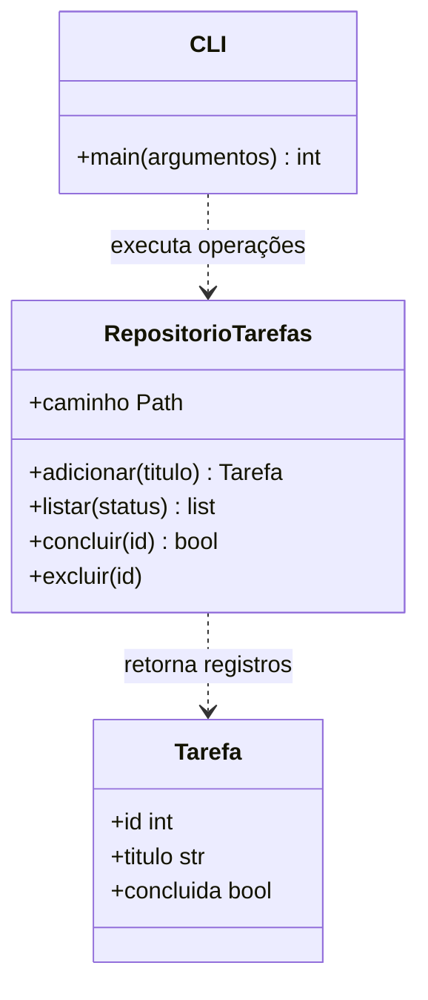

# Arquitetura e modelo de dados

## Organização

| Componente | Responsabilidade |
|---|---|
| `src/__main__.py` | Ponto de entrada de `python -m src`. |
| `src/cli.py` | Interpretar argumentos, exigir confirmação de exclusão e apresentar respostas/códigos de saída. |
| `src/tarefas.py` | Validar regras, representar tarefas e consultar/alterar o SQLite. |
| SQLite | Persistir os registros em um arquivo local. |
| `tests/` | Verificar regras e execução real da interface com bancos temporários. |

A CLI chama o repositório. O repositório abre uma conexão por operação, cria a tabela quando necessário e usa transação para confirmar ou desfazer alterações. A conexão é fechada ao final da operação. A versão do produto fica em `src/__init__.py`.

## Diagrama de classes

`CLI` representa o módulo de interface no diagrama; o código não declara uma classe com esse nome. `Tarefa` é uma dataclass imutável. O estado persistido só é alterado por operações do repositório.

## Tabela `tarefas`

| Coluna | Tipo SQLite | Restrições e significado |
|---|---|---|
| `id` | INTEGER | Chave primária com AUTOINCREMENT; gerada pelo banco, sem reutilização de IDs excluídos. |
| `titulo` | TEXT | NOT NULL e CHECK de comprimento entre 1 e 120; a aplicação normaliza espaços e verifica caracteres imprimíveis. |
| `concluida` | INTEGER | NOT NULL, padrão 0, CHECK para 0 ou 1; 0 = pendente e 1 = concluída. |

Não há relações com outras entidades na versão inicial. Títulos não são únicos. Não são armazenados usuário, prazo ou categoria porque esses dados estão fora do escopo.

## Decisões e limites

- **Terminal:** adequado ao escopo de uma semana e verificável por processos automatizados.
- **SQLite:** oferece persistência e transações sem servidor nem instalação adicional de pacotes.
- **Biblioteca padrão:** reduz configuração e dependências; `argparse` trata a sintaxe e `unittest` executa os testes.
- **SQL parametrizado:** títulos são tratados como dados e não como comandos SQL.
- **Uso local:** sem servidor, autenticação ou envio de dados pela aplicação. O controle de acesso ao arquivo é responsabilidade do sistema operacional.
- **Backup:** não há automação; uma cópia manual deve ser feita com a aplicação fechada.
